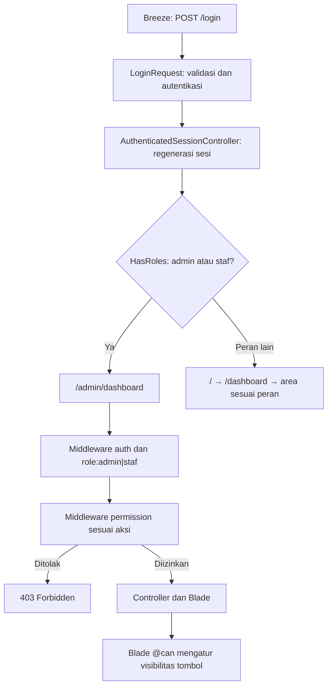
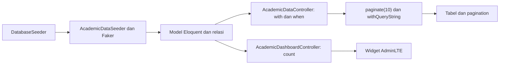
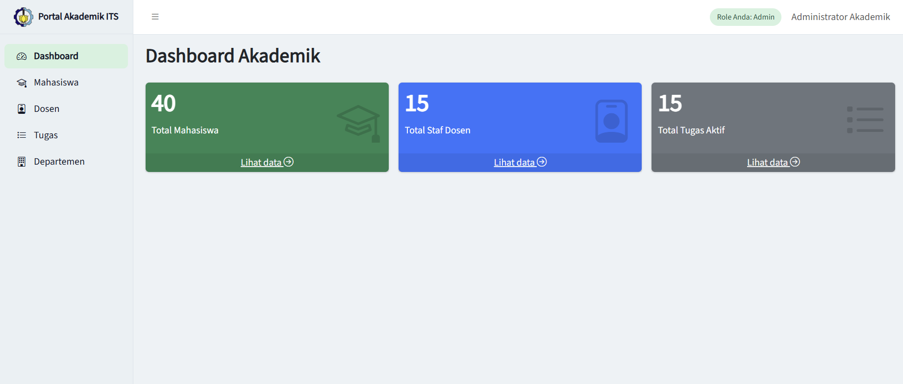
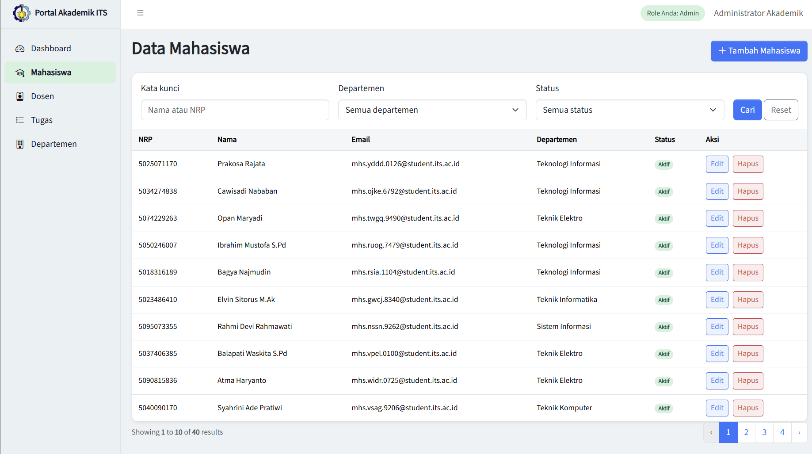
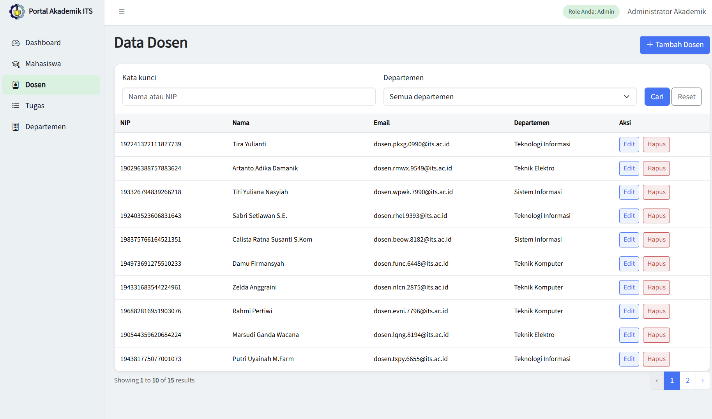
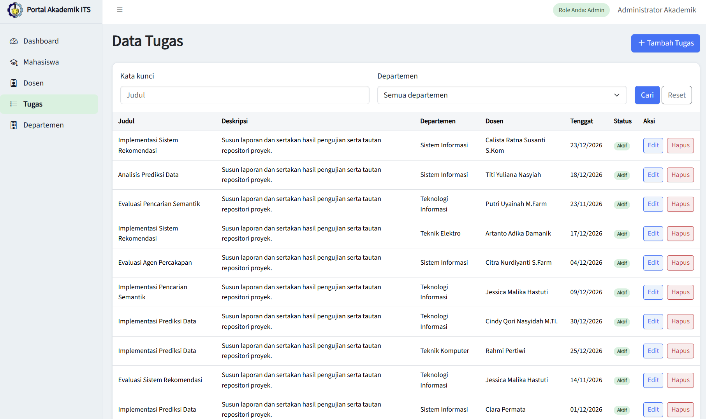
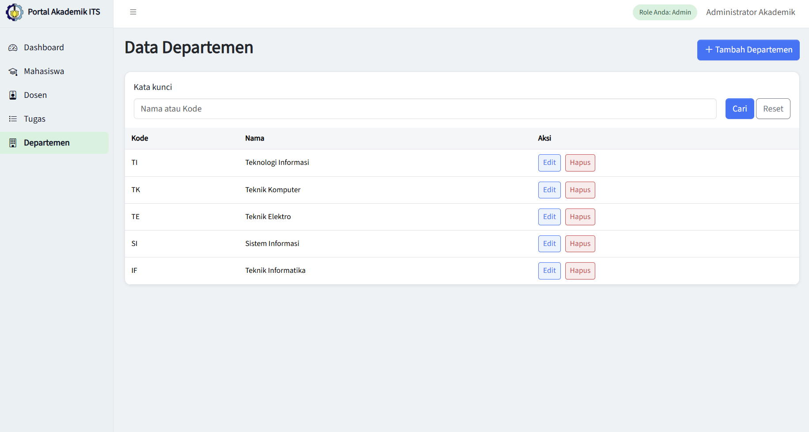
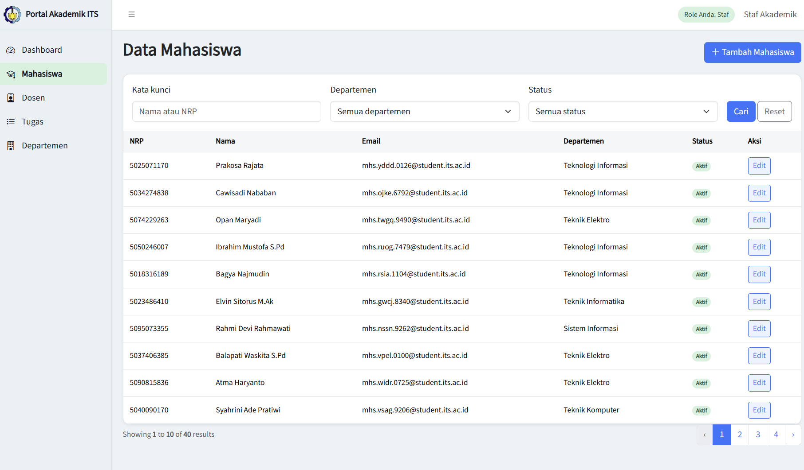

# Portal Akademik ITS — Admin Dashboard & RBAC


## 1. Ringkasan Proyek & Fitur Utama

Portal Akademik ITS menyediakan panel pengelolaan data akademik dan area proposal proyek AI mahasiswa. Panel memakai Breeze untuk login, AdminLTE untuk antarmuka, dan Spatie Laravel Permission untuk menyimpan peran dan izin.

| Modul               | Rute                | Fungsi                                                 |
| ------------------- | ------------------- | ------------------------------------------------------ |
| Dashboard Statistik | `/admin/dashboard`  | Total mahasiswa, staf dosen, dan tugas aktif           |
| Mahasiswa           | `/admin/mahasiswa`  | CRUD, pencarian nama/NRP, filter departemen dan status |
| Dosen               | `/admin/dosen`      | CRUD, pencarian nama/NIP, filter departemen            |
| Tugas               | `/admin/tugas`      | CRUD, pencarian judul, filter departemen               |
| Departemen          | `/admin/departemen` | CRUD dan pencarian nama/kode                           |

Admin dapat melihat, menambah, mengedit, dan menghapus data. Staf dapat melihat, menambah, dan mengedit data. Area mahasiswa tersedia di `/beranda` dan `/proposals`, sedangkan dosen dan asdos meninjau proposal di `/review/proposals`.

## 2. Prasyarat & Panduan Setup

-   **PHP 8.3 atau lebih baru.** [composer.json](composer.json) mendeklarasikan `^8.2`, sementara Spatie Permission 8.5 pada [composer.lock](composer.lock) membutuhkan `^8.3`.
-   **Composer 2**, **npm**, dan **Node.js 20.19+ pada seri 20 atau 22.12+** untuk Vite 7.
-   **SQLite** dengan `pdo_sqlite` merupakan pilihan bawaan. MySQL dan MariaDB dengan `pdo_mysql` juga tersedia di [config/database.php](config/database.php).

### Instalasi lokal

1. Clone repositori.

    ```bash
    git clone https://github.com/Kifrx/PBKK-W4.git
    cd PBKK-W4
    ```

2. Instal dependensi dan build aset frontend.

    ```bash
    composer install
    npm install && npm run build
    ```

3. Salin konfigurasi, siapkan file SQLite, dan buat app key. Contoh berikut memakai Bash.

    ```bash
    cp .env.example .env
    touch database/database.sqlite
    php artisan key:generate
    ```

    Untuk PowerShell, gunakan perintah berikut.

    ```powershell
    Copy-Item .env.example .env
    if (-not (Test-Path database/database.sqlite)) { New-Item -ItemType File database/database.sqlite }
    php artisan key:generate
    ```

    Untuk MySQL atau MariaDB, buat database dan isi `DB_CONNECTION` dengan `mysql` atau `mariadb`, lalu sesuaikan `DB_HOST`, `DB_PORT`, `DB_DATABASE`, `DB_USERNAME`, dan `DB_PASSWORD`.

4. Jalankan migrasi dan seeder, lalu publikasikan aset AdminLTE.

    ```bash
    php artisan migrate --seed
    php artisan adminlte:install --only=assets
    ```

5. Jalankan server dan buka [halaman login](http://127.0.0.1:8000/login).

    ```bash
    php artisan serve
    ```

> Pada Windows PowerShell 5.1, jalankan `npm install` dan `npm run build` pada baris terpisah.

### Akun uji coba & Auto-Login

| Role  | Email             | Password   | Hak akses                  |
| ----- | ----------------- | ---------- | -------------------------- |
| Admin | `admin@its.ac.id` | `password` | Lihat, tambah, edit, hapus |
| Staf  | `staf@its.ac.id`  | `password` | Lihat, tambah, edit        |

> Setelah seeder berjalan, gunakan `APP_ENV=local` untuk menampilkan **Auto-Login Admin** dan **Auto-Login Staf**. Klik tombol peran untuk masuk ke `/admin/dashboard`. Keluar terlebih dahulu sebelum berganti akun. Kredensial demo ditujukan untuk database lokal.

## 3. Arsitektur & Pipeline Sistem

### Autentikasi dan otorisasi



Izin panel tersimpan di `roles`, `permissions`, `model_has_roles`, `model_has_permissions`, dan `role_has_permissions` sesuai [config/permission.php](config/permission.php). Alias `role` dan `permission` terdaftar di [bootstrap/app.php](bootstrap/app.php). Middleware rute memeriksa izin sebelum controller dijalankan. Area mahasiswa, dosen, dan asdos menggunakan `users.role` dan middleware `cek.peran`.

### Data, widget, dan filter



| Model        | Tabel         | Kolom utama dan relasi                                                     |
| ------------ | ------------- | -------------------------------------------------------------------------- |
| `Departemen` | `departemens` | `kode`, `nama`                                                             |
| `Dosen`      | `dosens`      | `nip`, `nama`, `email`, `departemen_id`                                    |
| `Mahasiswa`  | `mahasiswas`  | `nrp`, `nama`, `email`, `departemen_id`, `is_active`                       |
| `Tugas`      | `tugas`       | `judul`, `deskripsi`, `deadline`, `is_active`, `departemen_id`, `dosen_id` |

Departemen direferensikan oleh dosen, mahasiswa, dan tugas. Tugas juga merujuk ke dosen. Foreign key melindungi departemen dan dosen yang masih dirujuk dari penghapusan. Widget tugas aktif menghitung tugas dengan `is_active` bernilai benar dan `deadline` hari ini atau setelahnya.

## 4. Foto Dokumentasi Portal

|                        Screenshot                        | Deskripsi                                  |
| :------------------------------------------------------: | :----------------------------------------- |
|              | Tiga widget statistik dan badge peran      |
|    | Pencarian nama/NRP, departemen, dan status |
|            | Pencarian nama/NIP dan departemen          |
|            | Pencarian judul dan departemen             |
|  | Tabel dan pencarian nama/kode              |
|                 | menampilkan tombol staff                   |

## 5. Implementasi Tugas & Challenge

### A. Implementasi Tugas Wajib

#### Step 1 — Integrasi UI Dashboard & Konfigurasi Tema/Logo

**Tujuan.** Menyatukan tema terang, lambang ITS, dan menu sidebar dengan layout AdminLTE. Halaman panel mewarisi `academic.layout`.

**File.** [config/adminlte.php](config/adminlte.php), [resources/views/academic/layout.blade.php](resources/views/academic/layout.blade.php), [public/logo-its.png](public/logo-its.png).

```php
return [
    'title' => 'Portal Akademik ITS',
    'logo' => 'Portal Akademik ITS',
    'logo_img' => 'logo-its.png',
    'logo_img_alt' => 'Lambang ITS',
    'logo_img_class' => 'brand-image',
    'classes_brand_text' => 'fw-semibold',
    'classes_sidebar' => 'academic-sidebar',
    'classes_topnav' => 'academic-topbar',
    'color_mode' => [
        'enabled' => false,
        'default' => 'light',
        'remember' => false,
        'routes' => false,
    ],
    'dashboard_url' => 'admin/dashboard',
    'logout_url' => 'logout',
    'logout_method' => 'POST',
    'menu' => [
        ['text' => 'Dashboard', 'route' => 'admin.dashboard', 'icon' => 'bi bi-speedometer2', 'can' => 'lihat-data'],
        ['text' => 'Mahasiswa', 'route' => 'admin.mahasiswa.index', 'icon' => 'bi bi-mortarboard', 'can' => 'lihat-data'],
        ['text' => 'Dosen', 'route' => 'admin.dosen.index', 'icon' => 'bi bi-person-badge', 'can' => 'lihat-data'],
        ['text' => 'Tugas', 'route' => 'admin.tugas.index', 'icon' => 'bi bi-list-task', 'can' => 'lihat-data'],
        ['text' => 'Departemen', 'route' => 'admin.departemen.index', 'icon' => 'bi bi-building', 'can' => 'lihat-data'],
    ],
];
```

```blade
@extends('adminlte::page')
```

#### Step 2 — Autentikasi Multi-User (Laravel Breeze) & Redirect Dashboard

**Tujuan.** Memverifikasi kredensial dan meregenerasi sesi. Admin dan staf menuju panel akademik. Pengguna lain masuk melalui `home.entry` dan `dashboard`.

**File.** [routes/auth.php](routes/auth.php), [routes/web.php](routes/web.php), [app/Http/Controllers/Auth/AuthenticatedSessionController.php](app/Http/Controllers/Auth/AuthenticatedSessionController.php), [app/Http/Requests/Auth/LoginRequest.php](app/Http/Requests/Auth/LoginRequest.php).

```php
    Route::get('login', [AuthenticatedSessionController::class, 'create'])
        ->name('login');

    Route::post('login', [AuthenticatedSessionController::class, 'store']);
```

```php
    public function store(LoginRequest $request): RedirectResponse
    {
        $request->authenticate();

        $request->session()->regenerate();
        $request->session()->forget('url.intended');

        if ($request->user()->hasAnyRole(['admin', 'staf'])) {
            return to_route('admin.dashboard');
        }

        return redirect(route('home.entry', absolute: false));
    }
```

```php
    Route::get('/dashboard', function (Request $request, PageController $pages) {
        if ($request->user()->hasAnyRole(['admin', 'staf'])) {
            return to_route('admin.dashboard');
        }

        if ($request->user()->can('kelola-portal')) {
            return redirect()->route('admin.proposals.index');
        }

        return $pages->index($request);
    })->name('dashboard');
```

#### Step 3 — Setup RBAC Dinamis via Spatie Laravel Permission

**Tujuan.** Menambahkan `HasRoles` ke model `User` dan menyinkronkan izin per peran dengan guard `web`.

**File.** [app/Models/User.php](app/Models/User.php), [database/seeders/RoleAndPermissionSeeder.php](database/seeders/RoleAndPermissionSeeder.php), [config/permission.php](config/permission.php), [database/migrations/2026_11_09_070120_create_permission_tables.php](database/migrations/2026_11_09_070120_create_permission_tables.php).

```php
use Spatie\Permission\Traits\HasRoles;

class User extends Authenticatable
{
    /** @use HasFactory<\Database\Factories\UserFactory> */
    use HasFactory, HasRoles, Notifiable;
```

```php
    public function run(): void
    {
        app(PermissionRegistrar::class)->forgetCachedPermissions();

        $permissions = ['lihat-data', 'tambah-data', 'edit-data', 'hapus-data'];
        foreach ($permissions as $permission) {
            Permission::firstOrCreate(['name' => $permission, 'guard_name' => 'web']);
        }

        foreach (['admin' => 'Administrator Akademik', 'staf' => 'Staf Akademik'] as $roleName => $name) {
            $role = Role::firstOrCreate(['name' => $roleName, 'guard_name' => 'web']);
            $role->syncPermissions($roleName === 'admin' ? $permissions : array_diff($permissions, ['hapus-data']));

            $user = User::firstOrCreate(
                ['email' => $roleName.'@its.ac.id'],
                ['name' => $name, 'password' => Hash::make('password')],
            );

            if ($user->wasRecentlyCreated) {
                $user->assignRole($role);
            } elseif (! $user->hasRole($role)) {
                throw new RuntimeException("Email {$user->email} sudah digunakan oleh akun lain.");
            }
        }
    }
```

#### Step 4 — Widget Statistik Dinamis Dashboard

**Tujuan.** Menghitung statistik dari database dan merender setiap hasil sebagai widget AdminLTE.

**File.** [app/Http/Controllers/AcademicDashboardController.php](app/Http/Controllers/AcademicDashboardController.php), [resources/views/academic/dashboard.blade.php](resources/views/academic/dashboard.blade.php).

```php
    public function __invoke(): View
    {
        $statistics = [
            ['label' => 'Total Mahasiswa', 'count' => Mahasiswa::count(), 'icon' => 'bi bi-mortarboard', 'theme' => 'success', 'route' => 'admin.mahasiswa.index'],
            ['label' => 'Total Staf Dosen', 'count' => Dosen::count(), 'icon' => 'bi bi-person-badge', 'theme' => 'primary', 'route' => 'admin.dosen.index'],
            ['label' => 'Total Tugas Aktif', 'count' => Tugas::where('is_active', true)->where('deadline', '>=', today()->toDateString())->count(), 'icon' => 'bi bi-list-task', 'theme' => 'secondary', 'route' => 'admin.tugas.index'],
        ];

        return view('academic.dashboard', compact('statistics'));
    }
```

```blade
@section('content')
    <div class="row g-3">
        @foreach ($statistics as $statistic)
            <div class="col-12 col-md-4">
                <div class="small-box text-bg-{{ $statistic['theme'] }}">
                    <div class="inner">
                        <h2 class="h1 fw-bold">{{ number_format($statistic['count'], 0, ',', '.') }}</h2>
                        <p>{{ $statistic['label'] }}</p>
                    </div>
                    <i class="small-box-icon {{ $statistic['icon'] }}" aria-hidden="true"></i>
                    <a href="{{ route($statistic['route']) }}" class="small-box-footer link-light">
                        Lihat data <i class="bi bi-arrow-right-circle" aria-hidden="true"></i>
                    </a>
                </div>
            </div>
        @endforeach
    </div>
@stop
```

#### Step 5 — Pengaman Berlapis

**Tujuan.** Grup panel memeriksa peran. Rute hapus memeriksa izin sebelum controller dipanggil, dan Blade menyembunyikan tombol jika izin tidak tersedia.

**File.** [routes/web.php](routes/web.php), [bootstrap/app.php](bootstrap/app.php), [app/Http/Controllers/AcademicDataController.php](app/Http/Controllers/AcademicDataController.php), [resources/views/academic/index.blade.php](resources/views/academic/index.blade.php).

```php
Route::prefix('admin')->name('admin.')->middleware(['auth', 'role:admin|staf'])->group(function () {
    Route::get('/dashboard', AcademicDashboardController::class)
        ->middleware('permission:lihat-data')->name('dashboard');

    foreach (array_keys(config('academic')) as $module) {
        Route::prefix($module)->name($module.'.')->group(function () use ($module) {
            Route::get('/', [AcademicDataController::class, 'index'])
                ->defaults('module', $module)->middleware('permission:lihat-data')->name('index');
            Route::get('/create', [AcademicDataController::class, 'create'])
                ->defaults('module', $module)->middleware('permission:tambah-data')->name('create');
            Route::post('/', [AcademicDataController::class, 'store'])
                ->defaults('module', $module)->middleware('permission:tambah-data')->name('store');
            Route::get('/{record}/edit', [AcademicDataController::class, 'edit'])
                ->whereNumber('record')->defaults('module', $module)->middleware('permission:edit-data')->name('edit');
            Route::put('/{record}', [AcademicDataController::class, 'update'])
                ->whereNumber('record')->defaults('module', $module)->middleware('permission:edit-data')->name('update');
            Route::delete('/{record}', [AcademicDataController::class, 'destroy'])
                ->whereNumber('record')->defaults('module', $module)->middleware('permission:hapus-data')->name('destroy');
        });
    }
});
```

```blade
                                    @can('hapus-data')
                                        <form method="POST" action="{{ route("admin.{$module}.destroy", $record) }}"
                                              onsubmit="return confirm('Hapus data ini?')">
                                            @csrf
                                            @method('DELETE')
                                            <button type="submit" class="btn btn-sm btn-outline-danger">Hapus</button>
                                        </form>
                                    @endcan
```

### B. Implementasi Challenge (Nilai Plus A+)

#### Challenge 1 — Filter Pencarian & Multi-Variabel dengan `when()`

**Tujuan.** Mengelompokkan pencarian OR pada kolom sesuai modul. Filter departemen dan status diterapkan jika tersedia. Nilai `0` tetap diproses sebagai Cuti.

**File.** [config/academic.php](config/academic.php), [app/Http/Controllers/AcademicDataController.php](app/Http/Controllers/AcademicDataController.php), [resources/views/academic/index.blade.php](resources/views/academic/index.blade.php).

```php
        $records = $model::with($relations)
            ->when($keyword !== '', function (Builder $query) use ($definition, $keyword) {
                $query->where(function (Builder $search) use ($definition, $keyword) {
                    foreach ($definition['search'] as $column) {
                        $search->orWhere($column, 'like', "%{$keyword}%");
                    }
                });
            })
            ->when($hasDepartment && $department !== null, fn (Builder $query) => $query->where('departemen_id', $department))
            ->when($module === 'mahasiswa' && $active !== null, fn (Builder $query) => $query->where('is_active', $active))
            ->orderByDesc('id')
            ->paginate(10)
            ->withQueryString();
```

```blade
            <form method="GET" action="{{ route("admin.{$module}.index") }}" class="row g-3 align-items-end">
                <div class="col-sm">
                    <label class="form-label" for="q">Kata kunci</label>
                    <input class="form-control" type="search" name="q" id="q" maxlength="100"
                           value="{{ $filters['q'] ?? '' }}" placeholder="{{ implode(' atau ', array_map(fn ($key) => $definition['fields'][$key], $definition['search'])) }}">
                </div>
                @if ($hasDepartment)
                    <div class="col-sm">
                        <label class="form-label" for="departemen_id">Departemen</label>
                        <select class="form-select" id="departemen_id" name="departemen_id">
                            <option value="">Semua departemen</option>
                            @foreach ($departments as $id => $name)
                                <option value="{{ $id }}" @selected(($filters['departemen_id'] ?? null) == $id)>{{ $name }}</option>
                            @endforeach
                        </select>
                    </div>
                @endif
                @if ($module === 'mahasiswa')
                    <div class="col-sm">
                        <label class="form-label" for="is_active">Status</label>
                        <select class="form-select" id="is_active" name="is_active">
                            <option value="">Semua status</option>
                            <option value="1" @selected((string) ($filters['is_active'] ?? '') === '1')>Aktif</option>
                            <option value="0" @selected((string) ($filters['is_active'] ?? '') === '0')>Cuti</option>
                        </select>
                    </div>
                @endif
                <div class="col-sm-auto">
                    <button class="btn btn-primary" type="submit">Cari</button>
                    <a class="btn btn-outline-secondary" href="{{ route("admin.{$module}.index") }}">Reset</a>
                </div>
            </form>
```

#### Challenge 2 — Pengunci Parameter Filter pada Pagination

**Tujuan.** Menampilkan 10 baris per halaman sambil membawa query filter. Blade memilih template Bootstrap 5 langsung.

**File.** [app/Http/Controllers/AcademicDataController.php](app/Http/Controllers/AcademicDataController.php), [resources/views/academic/index.blade.php](resources/views/academic/index.blade.php).

```php
            ->orderByDesc('id')
            ->paginate(10)
            ->withQueryString();
```

```blade
    @if ($records->hasPages())
        {{ $records->links('pagination::bootstrap-5') }}
    @endif
```

#### Challenge 3 — Auto-Seeder Faker Realistis

**Tujuan.** Mengisi database baru dengan lima departemen, 15 dosen, 40 mahasiswa, dan 20 tugas. Departemen ditentukan di seeder, sementara factory membuat data dosen, mahasiswa, dan tugas jika tabel terkait masih kosong.

**File.** [database/seeders/DatabaseSeeder.php](database/seeders/DatabaseSeeder.php), [database/seeders/AcademicDataSeeder.php](database/seeders/AcademicDataSeeder.php), [database/factories/DepartemenFactory.php](database/factories/DepartemenFactory.php), [database/factories/DosenFactory.php](database/factories/DosenFactory.php), [database/factories/MahasiswaFactory.php](database/factories/MahasiswaFactory.php), [database/factories/TugasFactory.php](database/factories/TugasFactory.php).

```php
        $this->call([
            RoleAndPermissionSeeder::class,
            AcademicDataSeeder::class,
        ]);
```

```php
    public function run(): void
    {
        $departments = collect([
            'IF' => 'Teknik Informatika',
            'SI' => 'Sistem Informasi',
            'TE' => 'Teknik Elektro',
            'TK' => 'Teknik Komputer',
            'TI' => 'Teknologi Informasi',
        ])->map(fn ($name, $code) => Departemen::firstOrCreate(['kode' => $code], ['nama' => $name]));

        if (! Dosen::exists()) {
            Dosen::factory(15)->state(fn () => ['departemen_id' => $departments->random()->id])->create();
        }

        if (! Mahasiswa::exists()) {
            Mahasiswa::factory(40)->state(fn () => ['departemen_id' => $departments->random()->id])->create();
        }

        if (! Tugas::exists()) {
            $lecturers = Dosen::all(['id', 'departemen_id']);
            Tugas::factory(20)->state(function () use ($lecturers) {
                $lecturer = $lecturers->random();

                return ['dosen_id' => $lecturer->id, 'departemen_id' => $lecturer->departemen_id];
            })->create();
        }
    }
```

```php
    public function definition(): array
    {
        return [
            'nrp' => fake()->unique()->numerify('50########'),
            'nama' => fake('id_ID')->name(),
            'email' => fake()->unique()->bothify('mhs.????.####@student.its.ac.id'),
            'departemen_id' => Departemen::factory(),
            'is_active' => fake()->boolean(85),
        ];
    }
```

#### Challenge 4 — Tombol Auto-Login Test Accounts

**Tujuan.** Form demo hanya muncul pada lingkungan `local` dan mengirim kredensial seed melalui `POST /login` dengan CSRF. Rute yang sama menjalankan `AuthenticatedSessionController::store()` sebagaimana pada Step 2.

**File.** [resources/views/auth/login.blade.php](resources/views/auth/login.blade.php), [routes/auth.php](routes/auth.php), [app/Http/Controllers/Auth/AuthenticatedSessionController.php](app/Http/Controllers/Auth/AuthenticatedSessionController.php), [database/seeders/RoleAndPermissionSeeder.php](database/seeders/RoleAndPermissionSeeder.php).

```php
    Route::post('login', [AuthenticatedSessionController::class, 'store']);
```

```blade
    @if (app()->environment('local'))
        <div class="mt-5 rounded-xl border border-emerald-100 bg-emerald-50 p-3">
            <p class="mb-2 text-xs font-semibold text-emerald-900">Akun demo lokal</p>
            <div class="flex flex-wrap gap-2">
                @foreach (['Admin' => 'admin', 'Staf' => 'staf'] as $label => $account)
                    <form method="POST" action="{{ route('login') }}">
                        @csrf
                        <input type="hidden" name="email" value="{{ $account }}@its.ac.id">
                        <input type="hidden" name="password" value="password">
                        <button type="submit" class="rounded-lg border border-emerald-200 bg-white px-3 py-2 text-xs font-semibold text-emerald-900 hover:bg-emerald-100">
                            Auto-Login {{ $label }}
                        </button>
                    </form>
                @endforeach
            </div>
        </div>
    @endif
```
